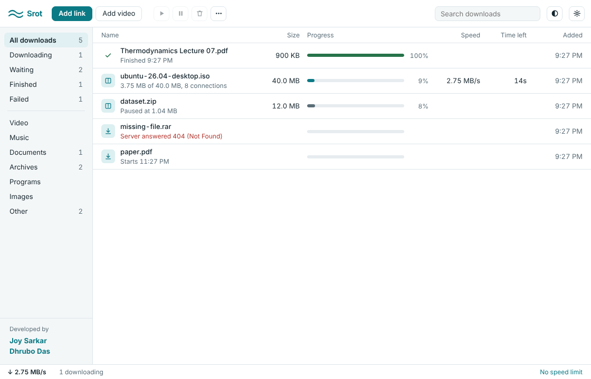
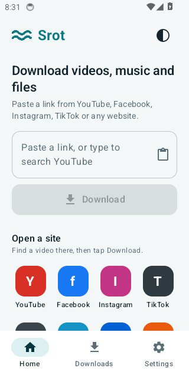
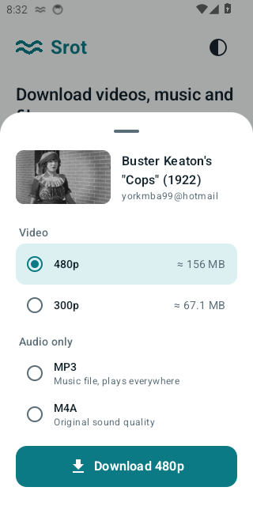
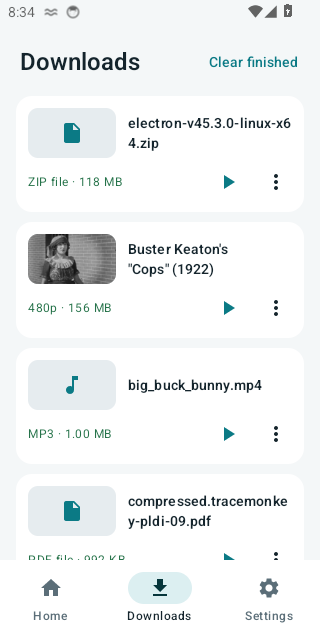

<p align="center">
  
</p>

<h1 align="center">Srot</h1>

<p align="center">
  A free download manager for <b>Windows, Mac and Android</b>.<br>
  Fast downloads you can pause and resume, plus videos and music from YouTube, Facebook, Instagram, TikTok and 1000+ other sites.
</p>

<p align="center">
  <a href="../../releases/latest"><b>⬇ Download Srot</b></a>
  &nbsp;·&nbsp; <a href="#install">How to install</a>
  &nbsp;·&nbsp; <a href="#বাংলায়">বাংলায় পড়ুন</a>
</p>

<p align="center">Developed by <b>Joy Sarkar and Dhrubo Das</b></p>

---

<p align="center">
  
</p>
<p align="center">
  
  &nbsp;
  
  &nbsp;
  
</p>

## Download

Get the newest version from the **[Releases page](../../releases/latest)** and pick the file for your device:

| Your device | File |
|---|---|
| Android phone (almost all phones) | `Srot-android-arm64-v8a.apk` |
| Older or low-cost Android phone, if the one above will not install | `Srot-android-armeabi-v7a.apk` |
| Android, not sure which | `Srot-android-universal.apk` (bigger, works on every phone) |
| Windows 10 or 11 | `Srot-windows-x64.zip` |
| Mac with an Apple chip (M1, M2, M3, M4…) | `Srot-mac-arm64.zip` |
| Mac with an Intel chip | `Srot-mac-x64.zip` |
| Chrome or Edge extension, for the Windows and Mac app | `Srot-browser-extension.zip` |

Not sure which Mac you have? Apple menu → **About This Mac**: "Chip: Apple M…" means Apple chip, "Processor: Intel…" means Intel.

## What it does

**On Windows and Mac**
- Splits each file across up to 32 connections, and moves a slow part to a faster connection while it runs
- Pause and resume, even after a crash, a restart or a lost connection
- A queue, a scheduler (start at a set time, or only download between certain hours) and a speed limit
- Videos from YouTube and 1000+ sites, as video or MP3
- A Chrome/Edge extension that hands your browser's downloads to Srot
- Paste a fresh link into a download whose link expired and it carries on where it stopped

**On Android**
- Tap **Share** on a video in YouTube, Facebook or any app and choose **Srot**, then pick a quality (144p up to 4K) or MP3
- A built-in browser with YouTube, Facebook, Instagram, TikTok, X, Vimeo and more; sign in once and Srot uses that sign-in
- Downloads keep going with the screen off, with progress in the notification bar
- Pause and resume, and 1 to 3 downloads at a time

**Everywhere:** light and dark mode, and no ads, accounts or tracking. The video engine ([yt-dlp](https://github.com/yt-dlp/yt-dlp)) updates itself, so it keeps working when sites change.

## Install

### Android
1. Download the `.apk` file on your phone and open it.
2. If asked, allow your browser or Files app to **install unknown apps**.
3. If Play Protect warns you, tap **More details → Install anyway**. It shows this for every app that is not from the Play Store.
4. Needs Android 8 or newer. Finished files go to **Download/Srot**.

### Windows
1. Right-click `Srot-windows-x64.zip` → **Extract All**.
2. Open the `Srot` folder and run **Srot.exe**. There is no installer: the folder is the app.
3. If Windows says "Windows protected your PC", click **More info → Run anyway**.

### Mac
1. Double-click the `.zip` and drag **Srot.app** into **Applications**.
2. Open Srot. The first time, macOS blocks it because it is not from the App Store: open **System Settings → Privacy & Security**, scroll down and click **Open Anyway**.
3. If macOS says the app "is damaged", open Terminal, run this once, then open Srot again:
   ```bash
   xattr -cr /Applications/Srot.app
   ```

### Browser extension (Chrome or Edge)
1. Unzip `Srot-browser-extension.zip` somewhere you will keep it.
2. Open `chrome://extensions` (or `edge://extensions`) and turn on **Developer mode**.
3. Click **Load unpacked** and choose the `Srot Browser Extension` folder.
4. In the Srot app, open **Settings → Browser** and copy the **pairing code**. Click the extension's icon → **Pairing code and options**, paste it, and click **Save and test**.

## Good to know

- **YouTube says "Sign in to confirm you're not a bot":** YouTube sometimes asks this on shared or VPN connections. On Android, open YouTube from Srot's home screen and sign in once, then try again.
- **A site stopped working:** sites change often. Srot updates its video engine by itself once a day; you can also update it now in **Settings**.
- Videos protected with DRM (Netflix, Prime Video and similar) cannot be downloaded.
- Please download only what you have the right to save.

## বাংলায়

**Srot (স্রোত)** একটা ফ্রি ডাউনলোড ম্যানেজার: Windows, Mac আর Android ফোনে চলে। ফাইল অনেক ভাগে একসাথে নামায় বলে দ্রুত, যেকোনো সময় pause/resume করা যায়, আর YouTube, Facebook, Instagram, TikTok সহ হাজারো সাইট থেকে ভিডিও বা MP3 নামানো যায়।

**নামাতে:** উপরের [Releases page](../../releases/latest)-এ যাও। Android ফোনে `Srot-android-arm64-v8a.apk`, Windows-এ `Srot-windows-x64.zip`, নতুন Mac-এ `Srot-mac-arm64.zip` নাও।

**Android-এ install:** APK খুলে Install চাপো। "Install unknown apps" চাইলে অনুমতি দাও, Play Protect সতর্ক করলে **More details → Install anyway**। এরপর YouTube বা যেকোনো অ্যাপে ভিডিওর **Share** চেপে **Srot** বেছে নিলেই quality বাছাইয়ের তালিকা আসবে। ফাইল যায় ফোনের **Download/Srot** ফোল্ডারে।

**Windows-এ:** zip-এ right-click → Extract All, তারপর `Srot` ফোল্ডারের **Srot.exe** চালাও। "Windows protected your PC" দেখালে **More info → Run anyway**।

**Mac-এ:** zip খুলে **Srot.app** Applications-এ রাখো। প্রথমবার আটকালে **System Settings → Privacy & Security → Open Anyway**।

**YouTube "not a bot" বললে:** Srot-এর Home থেকে YouTube খুলে একবার sign in করো, তারপর আবার চেষ্টা করো।

Developed by **Joy Sarkar and Dhrubo Das**.

## For developers

| Folder | What is inside |
|---|---|
| [`desktop/`](desktop) | Windows and Mac app: Electron, with a download engine in plain Node.js (no dependencies) and the browser extension in `desktop/extension` |
| [`android/`](android) | Android app: Kotlin and Jetpack Compose, with yt-dlp, Python, ffmpeg and QuickJS from [youtubedl-android](https://github.com/yausername/youtubedl-android) |

```bash
# Desktop (Node.js 20+)
cd desktop && npm install
npm start          # run the app
npm test           # engine tests
bash scripts/package-win.sh     # Windows zip
bash scripts/package-mac.sh     # Mac zip

# Android (JDK 17 and the Android SDK)
cd android && ./gradlew assembleRelease
```

Every push runs the desktop tests, the Android unit tests, and an Android emulator test that installs the app and downloads a PDF, an MP3 converted from a video, a video from archive.org, and a large file it pauses and resumes. Changing the number in [`VERSION`](VERSION) on `main` (or running the Release workflow from the Actions tab) builds every version and publishes them on the Releases page. Android releases are signed with Srot's key, which is stored encrypted in `android/signing/` and unlocked by the `SROT_SIGNING_PASSWORD` repository secret.

## License

[GNU GPL v3](LICENSE). Srot for Android includes youtubedl-android, yt-dlp, Python and ffmpeg under their own licenses.
